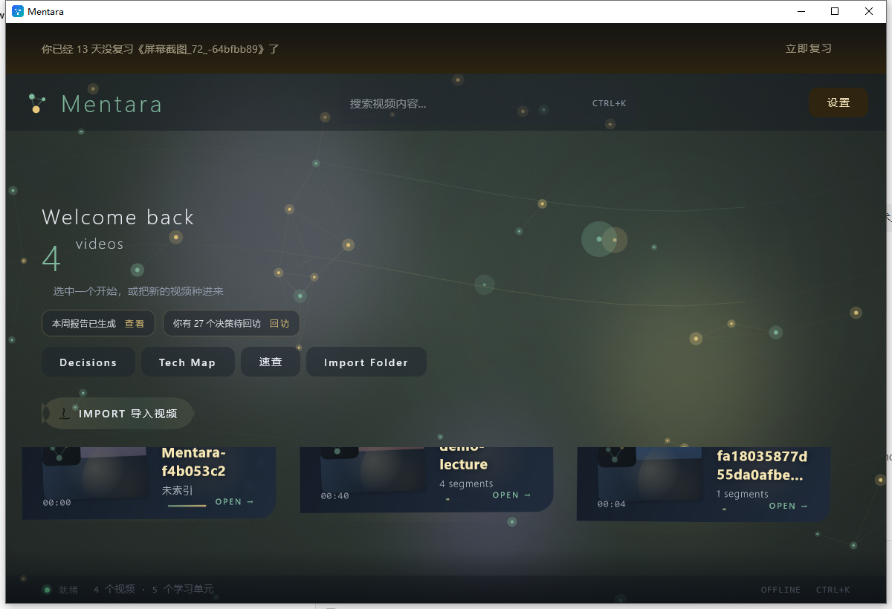
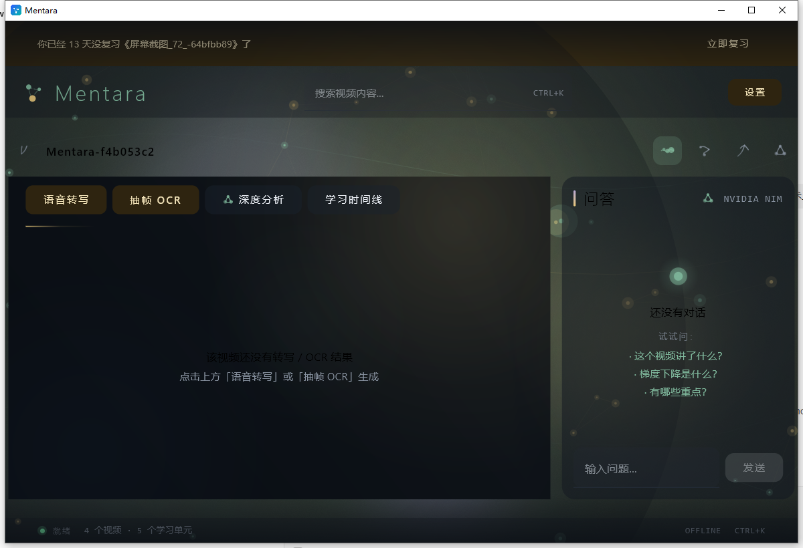
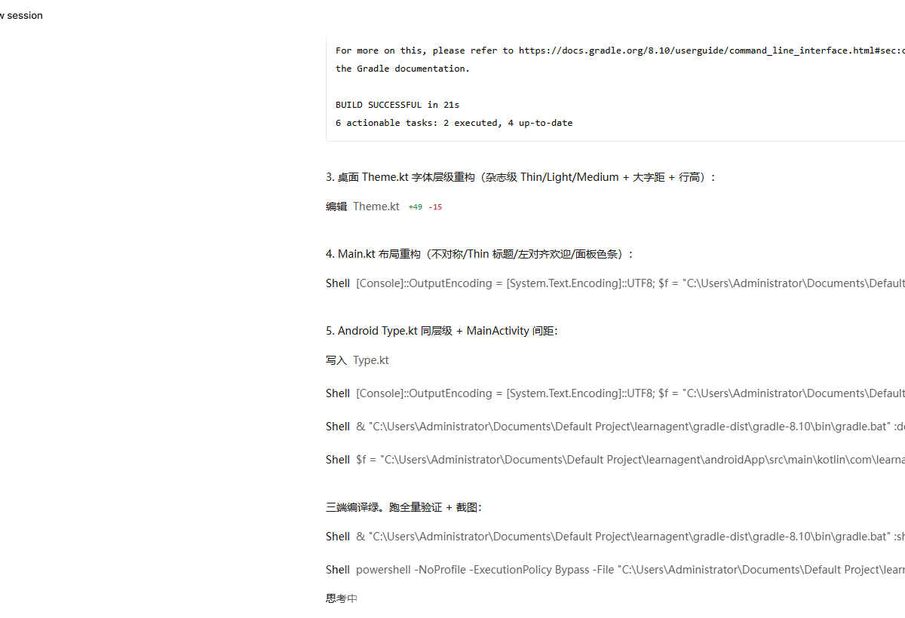

<div align="center">

# Mentara

**Turn any lecture video into clean, cited study notes — on mobile & desktop.**
**把任何网课视频变成干净、可溯源的学习笔记 —— 手机 + 桌面双端。**

[](#build)
[](LICENSE)
[](#build)
[](https://kotlinlang.org/)
[](CONTRIBUTING.md)

</div>

---

## Demo

> Screenshots coming — placeholders for the first release.

| Parse & Timeline | Debate (3 models) | Notes output |
|:-:|:-:|:-:|
|  |  |  |

---

## Features

- **Ingest everything, everywhere** — Import a lecture video (mp4/mkv/…), Mentara extracts 16 kHz mono audio and slices frames on-device.
- **1 fps + perceptual dedup** — Frames are compared via a 32×32 grayscale signature; ≥90 % similar frames skip OCR entirely. Slide decks stop burning your CPU.
- **Multimodal parse pipeline** — Speech (SenseVoice) and screen text (ML Kit OCR) are merged into one timeline `[mm:ss] speech | screen`.
- **SenseVoice, offline & bundled** — Chinese ASR (CER ≈ 5 % class) runs fully on-device via [`sherpa-onnx`](https://github.com/k2-fsa/sherpa-onnx). No account, no cloud, no heat.
- **Garbage-in firewall** — Regex pre-filters strip OCR garbage (player overlays, `TTTT` repeats, `TRACE`-style noise) and ASR hallucinations (`my when when when`) *before* any LLM sees them.
- **Vision proofreading (see-the-picture, fix-the-words)** — A VLM re-reads each screenshot and corrects the OCR text against what is *actually* on screen.
- **Consensus correction, chunked** — A second pass rewrites the merged transcript in 2 500-char chunks (no timeouts): typos fixed, repetition removed, Simplified-Chinese-only enforced, "no inventing" enforced.
- **Timeline as first-class UI** — The video and its parsed timeline live in the same pane; tap any line to jump and keep playing.
- **Permanent knowledge base** — Every parse writes `skill.md` (full archive) + notes; later Q&A answers with *your own video* as context, across videos.
- **3-model debate, background-proof** — Kimi / DeepSeek / GLM debate with per-seat fallback, phase checkmarks, elapsed timer; leaves the foreground without cancelling.
- **Built to be left alone** — Foreground service + wake-lock keep long parses alive with the screen off; screen stays on during parsing if you prefer.
- **Dual-platform, one core** — All domain logic lives in `shared/` (Kotlin Multiplatform). Android and Windows are thin UI shells.

---

## Architecture

```
shared/       Kotlin Multiplatform core — parser, ASR routing, OCR firewall,
              merge, consensus correction, debate engine, storage contracts
androidApp/   Jetpack Compose UI + sherpa-onnx (SenseVoice) + ML Kit OCR
desktopApp/   Compose Desktop UI + Windows media/OCR toolchain
```

> Why not `/android` and `/windows` side-by-side folders? Because every line of
> domain logic is shared through KMP — duplicating it per platform would be an
> anti-pattern. This three-module monorepo is the industry-standard layout for
> dual-platform Kotlin projects.

---

## Build

**Requirements**: JDK 17+, Android SDK (compileSdk 35), NDK 25.2+, CMake 3.22+

```bash
# 1) fetch the on-device ASR model once (~228 MB, hf-mirror)
powershell -File scripts/fetch-sensevoice-model.ps1

# 2) Android APK
./gradlew :androidApp:assembleDebug

# 3) Windows desktop
./gradlew :desktopApp:build

# 4) tests
./gradlew :shared:jvmTest
```

### Configuration

Runtime configuration (API keys, model choice) is entered **inside the app** —
nothing is hard-coded, nothing is committed. Local machine paths live in
`local.properties` (git-ignored).

---

## Known Issues

We ship honesty with the code:

- **OCR garbage in extreme scenes** — heavy subtitle burn-in, low-contrast text
  and rapid scene cuts can still yield artifacts. The regex firewall and VLM
  proofreading reduce this heavily, but are not (yet) bulletproof.
- **High-concurrency parsing is limited** — the on-device pipeline processes one
  video at a time by design; parallel Whisper/SenseVoice long-form inference is
  out of scope for phone-class hardware.
- **First-run install cost** — the bundled SenseVoice model adds ~210 MB to the
  APK and a one-time ~600 MB free-space requirement during install.
- **Long lectures are slow on low-end devices** — a 78-minute lecture with full
  VLM proofreading is measured in tens of minutes.

## Roadmap

- [ ] Stronger garbage regex bank + per-frame UI-region detection
- [ ] Obsidian plugin / vault sync (notes with `[[links]]` and timestamps)
- [ ] Abstract the dual-platform cores behind a single interface layer
- [ ] Subtitle burn-in export (`.srt` from ASR timeline)
- [ ] Batch queue: learn a whole course overnight

---

## Join Us

> I am a 17-year-old independent developer. 这是我从 0 到 1 的探索。代码可能不够完美，但双端同步的架构正在快速迭代。欢迎提 Issue，更渴望未来的合伙人能看见我。

---

## License

[MIT](LICENSE) © 2026 Mentara
